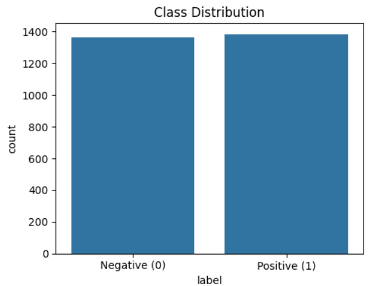

# Lab 01: Sentiment Analysis Using Traditional Machine Learning

## Laboratory Session
- **Module:** PUSL3205 – Large Language Models and Generative AI
- **Laboratory Session:** Lab 01 – Sentiment Analysis Using Traditional Machine Learning
- **Notebook:** `Lab_Sheet_1.ipynb`

## Objective
To practice basic Natural Language Processing (NLP) tasks—including text preprocessing, Bag-of-Words feature representation, and training and evaluating traditional machine learning classifiers (Logistic Regression and Linear SVM) on labelled sentiment sentences—to establish a baseline before exploring modern contextual language models and LLMs.

## Tasks and Implementation
1. **Load Dataset:** Downloaded and loaded the UCI Sentiment Labelled Sentences dataset (Amazon, IMDB, and Yelp reviews) into a `pandas` DataFrame.
2. **Text Preprocessing:** Converted text to lowercase, removed non-alphabetic characters and punctuation, collapsed extra whitespace into a `clean_text` column, and removed rows that became empty after cleaning.
3. **Exploratory Data Analysis (EDA):** Checked class distribution across positive (`1`) and negative (`0`) sentiment labels.
4. **Train/Test Split:** Split the cleaned dataset into training and testing sets using an 80/20 stratified split (`random_state=42`).
5. **Bag-of-Words Representation:** Converted text into numeric Bag-of-Words features using `CountVectorizer`, fitting on training data and transforming test data.
6. **Model Training:** Trained **Logistic Regression** and **Linear SVM** (`LinearSVC`) classifiers on the training features.
7. **Model Evaluation:** Evaluated both models on the test set using Accuracy, Precision, Recall, F1 Score, and confusion matrices.
8. **New Sentence Testing:** Tested both models on unseen sample sentences to observe sentiment predictions.

## Results and Evidence

### Evaluation Metrics (Test Set)
| Model | Accuracy | Precision | Recall | F1 Score |
| :--- | :--- | :--- | :--- | :--- |
| Logistic Regression | 0.84 | 0.8387 | 0.8448 | 0.8417 |
| Linear SVM | 0.82 | 0.8069 | 0.8448 | 0.8254 |

### New Sentence Predictions
- `"I really loved this movie, it was great!"` -> LR: Pos | SVM: Pos
- `"The food was cold and service was bad."` -> LR: Neg | SVM: Neg
- `"This phone has an amazing camera."` -> LR: Pos | SVM: Pos
- `"I would not recommend this to anyone."` -> LR: Neg | SVM: Neg

### Class Distribution

### Confusion Matrices

## Observations
- The dataset shows a balanced class distribution across negative (`0`) and positive (`1`) reviews.
- On this split, Logistic Regression achieved slightly higher accuracy (`0.84`) and F1 score (`0.8417`) than Linear SVM (`0.82` accuracy, `0.8254` F1 score), while both achieved the same recall (`0.8448`).
- Bag-of-Words models rely on word frequency rather than full contextual meaning or word order, which can be limiting on complex phrasing, negation, or sarcasm.

## Learning Outcomes
- Built a traditional NLP text classification pipeline in Python using `pandas`, `matplotlib`, `seaborn`, and `scikit-learn`.
- Practised text cleaning, stratified train/test splitting, and `CountVectorizer` feature extraction.
- Established a baseline workflow to compare against transformer models and large language models in later labs.
