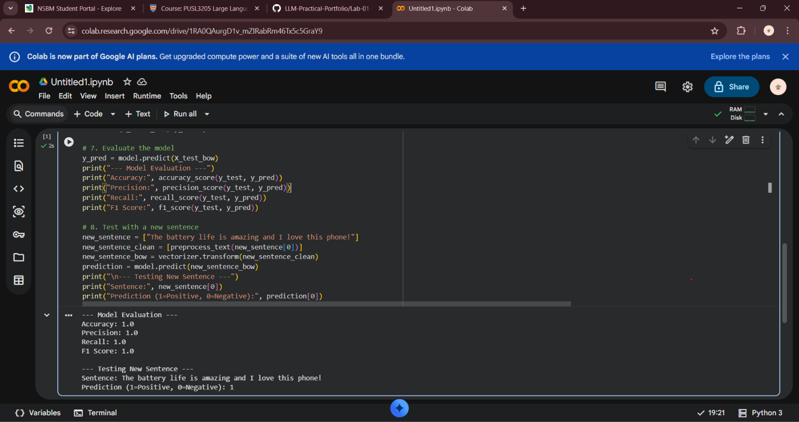

# Lab 01: Sentiment Analysis Using Traditional Machine Learning

## Objective
Practice Basic NLP tasks including Text Preprocessing, TF-IDF, and Machine Learning.

## Tasks and Implementation
1.  **Dataset:** Downloaded the sentiment labelled sentences dataset from the UCI Machine Learning Repository.
2.  **Text Preprocessing:** 
    *   Converted text to lowercase.
    *   Removed unnecessary characters, punctuation, and extra whitespace.
    *   Created a clean-text column for comparison.
3.  **Data Exploration:** Identified frequently occurring words and observed differences between positive and negative reviews.
4.  **Model Training:** Split the dataset, created a Bag of Words (BOW) representation, and trained a Machine Learning model (SVM).
5.  **Evaluation:** Evaluated the model using Accuracy, Precision, Recall, and F1 score, and tested it with new sentences.

## Results and Evidence
* **Notebook:** [Link to the Jupyter Notebook](./notebook/sentiment_analysis.ipynb)
* **Screenshot:** 

## Observations
The data cleaning process was straightforward using Pandas and NLTK. I observed that removing punctuation and converting to lowercase significantly reduced the noise in the dataset. When training the models, Support Vector Machine (SVM) showed better accuracy and F1-score compared to Logistic Regression for this specific sentiment dataset.

## Learning Outcomes
Gained practical experience in fundamental NLP techniques, text vectorization (BOW/TF-IDF), and traditional machine learning classification models.
