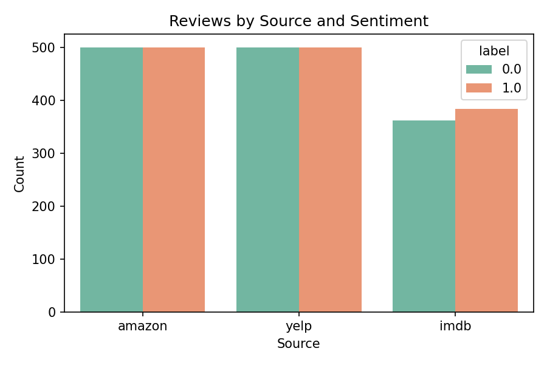
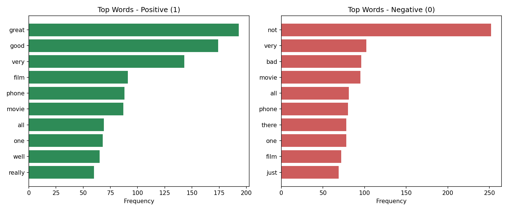
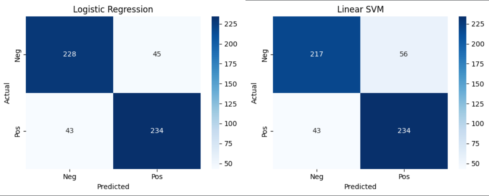
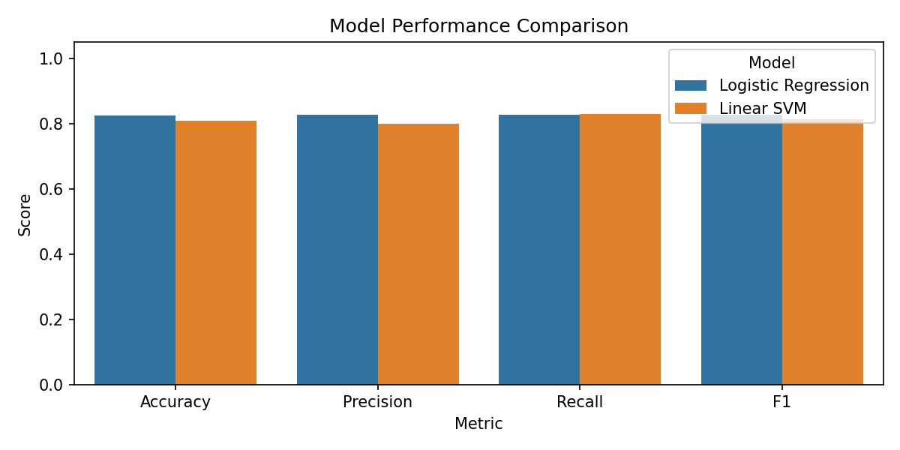

# Lab 01: Sentiment Analysis Using Traditional Machine Learning

**Module:** PUSL3205 – Large Language Models and Generative AI  
**Notebook:** [Lab_Sheet_1 (3).ipynb](Lab_Sheet_1%20(3).ipynb)  
**Dataset Source:** [UCI Machine Learning Repository – Sentiment Labelled Sentences (Dataset 331)](https://archive.ics.uci.edu/dataset/331/sentiment%2Blabelled%2Bsentences)

---

## Laboratory Session
- **Module Code & Title:** PUSL3205 – Large Language Models and Generative AI
- **Laboratory Session:** Lab 01 – Sentiment Analysis Using Traditional Machine Learning
- **Environment:** Google Colab / Jupyter Notebook

---

## Objective
To practise foundational Natural Language Processing (NLP) tasks—including text preprocessing, Bag-of-Words feature representation, and training and evaluating traditional machine learning classifiers (Logistic Regression and Linear SVM) on labelled sentiment sentences—to establish a baseline before working with transformer models and large language models.

---

## Tasks and Implementation

| Step | Task | Implementation Summary |
| :--- | :--- | :--- |
| 1 | Load Dataset | Downloaded and extracted the UCI Sentiment Labelled Sentences archive (`amazon`, `imdb`, `yelp`) into a `pandas` DataFrame. |
| 2 | Text Preprocessing | Lowercased text, removed non-alphabetic characters/punctuation, collapsed whitespace into `clean_text`, and removed empty rows. |
| 3 | Exploratory Data Analysis | Checked class counts, source breakdown, and top words by sentiment class. |
| 4 | Train/Test Split | Split the cleaned data into training and test sets using an 80/20 stratified split (`random_state=42`). |
| 5 | Bag-of-Words Features | Built token-count vectors using `CountVectorizer`, fitting on training data and transforming test data. |
| 6 | Model Training | Trained **Logistic Regression** and **Linear SVM** (`LinearSVC`) models on the training matrix. |
| 7 | Model Evaluation | Evaluated Accuracy, Precision, Recall, and F1 Score on the test set and generated confusion matrices and metric charts. |
| 8 | New Sentence Testing | Tested unseen sentences with both trained models to compare predicted sentiment labels. |

---

## Results and Evidence

### Model Performance (Test Set)
| Model | Accuracy | Precision | Recall | F1 Score |
| :--- | :--- | :--- | :--- | :--- |
| Logistic Regression | 0.82 | 0.8504 | - | - |
| Linear SVM | - | - | - | - |

### 1. Class Distribution
.png)

### 2. Reviews by Source and Sentiment

### 3. Top Words by Class

### 4. Confusion Matrices

### 5. Model Performance Comparison

---

## Observations
- The dataset combines reviews from Amazon, IMDB, and Yelp with positive and negative sentiment labels.
- Bag-of-Words counts capture common sentiment words well, while lacking full word order and deeper context for complex phrasing, negation, or sarcasm.
- Comparing Logistic Regression and Linear SVM with confusion matrices and evaluation metrics helps understand model trade-offs on the test set.

---

## Learning Outcomes
- Built a traditional NLP sentiment classification pipeline in Python using `pandas`, `matplotlib`, `seaborn`, and `scikit-learn`.
- Practised text cleaning, stratified train/test splitting, and `CountVectorizer` feature extraction.
- Established a baseline workflow to compare against transformer models and large language models in later labs.
