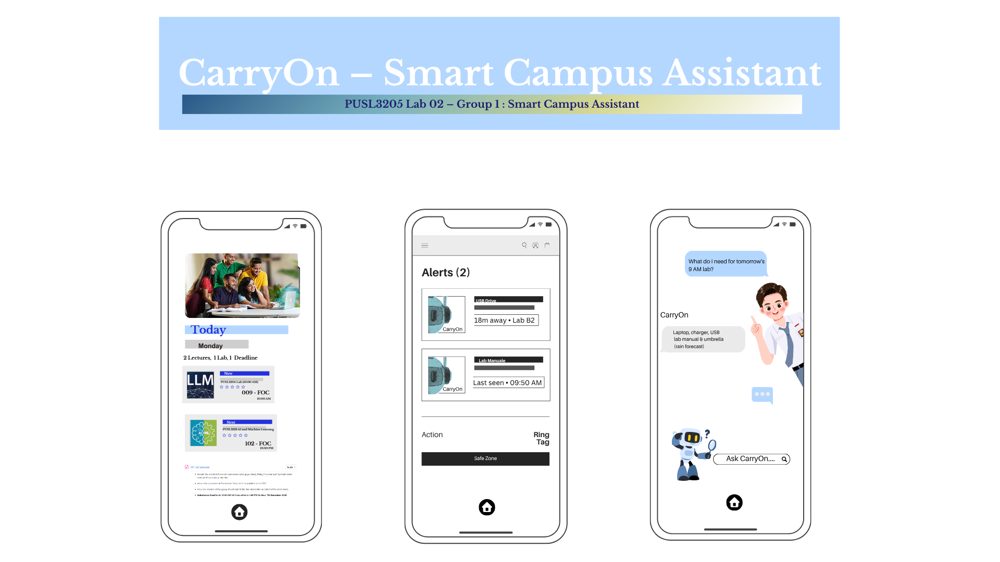

# Lab 02: LLMs in Everyday Life – The Forgetful Student

**Module:** PUSL 3205 – Large Language Models and Generative AI  
**Laboratory Session:** Lab 02 – AI in Everyday Challenges  
**Assigned Track:** Group 1 – The Forgetful Student  
**Project Name:** CarryOn – Context-Aware Campus Essentials Assistant  
**Group Documentation:** [`group-activity/`](group-activity/)

---

## Laboratory Session Overview
This laboratory session explores the practical application of Large Language Models (LLMs) as collaborative product-development partners. Rather than employing the LLM purely for conversational generation, the objective is to critically leverage the model to ideate, scope, architect, and stress-test an end-to-end intelligent solution for an everyday student challenge.

---

## Product Concept Summary: CarryOn
CarryOn is an intelligent campus companion combining localized on-device language models with low-power BLE smart beacons. By dynamically interpreting a student's modular timetable, academic deadlines, and environmental variables, CarryOn synthesizes a daily context-aware essentials checklist and proactively prevents items from being left behind.

Detailed specifications and collaboration artifacts are organized inside the [`group-activity/`](group-activity/) directory:
* [`group-members.md`](group-activity/group-members.md) – Team structure, individual roles, and contribution breakdown.
* [`activity-outcomes.md`](group-activity/activity-outcomes.md) – Formal product specification, feature taxonomy, and AI architecture.
* [`discussion-summary.md`](group-activity/discussion-summary.md) – LLM prompting transcripts, rejected iterations, trade-off evaluations, and critical reflection.

---

## Visual Prototype & Interface Mock-up
The mobile interface focuses on minimal cognitive friction, organized across three distinct functional views:
1. **Today View:** Timetable-driven dynamic checklist with activity context and essentials tracking.
2. **Alerts View:** Proximity/left-behind alerts displaying item status, distance/location details, and quick actions.
3. **Ask CarryOn View:** Conversational query interface supporting natural language packing and schedule questions.

---

## Key Observations
* **Generative vs. Deterministic Value:** Traditional rule-based calendar systems cannot deduce equipment requirements from free-text module announcements. The LLM's semantic reasoning fills this gap effectively.
* **The Necessity of Human Critical Filtering:** The LLM consistently favored high-complexity, privacy-invasive hardware configurations (e.g., RFID portals and constant cloud telemetry). Human intervention was necessary to pivot the system toward local execution, low-power BLE, and strict data privacy.

---

## Learning Outcomes
* Developed practical competency in utilizing LLMs as interactive ideation and system-scoping partners.
* Acquired experience translating abstract student pain points into structured, technically viable product architectures.
* Gained critical insights into the limitations of LLM proposals, emphasizing feasibility, sensor physics, and ethical privacy safeguards.
