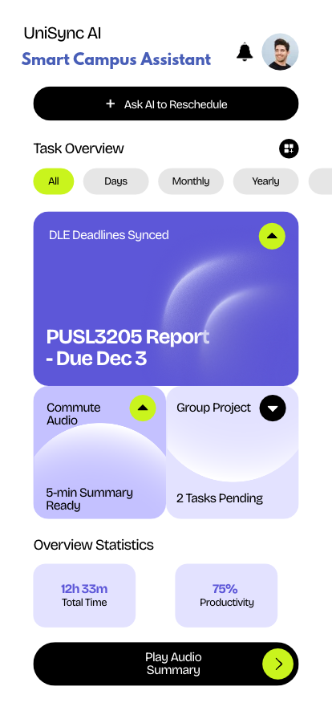

# Activity Outcomes: Product Concept

## 1. Product Name
**UniSync AI** (Smart Campus & Commute Companion)

## 2. Product Concept
UniSync AI is a practical time-management app built specifically for busy university students who juggle lectures, DLE deadlines, group projects, and long daily commutes. Instead of being just another calendar, it connects directly to the university LMS to turn scattered course deadlines into a realistic daily plan.

## 3. Target User
Undergraduate students who struggle with overlapping assignment deadlines, unresponsive group project members, and wasted travel time.

## 4. Key Features
* **DLE Auto-Sync:** Automatically pulls assignment submission dates and lecture updates from the university portal so nothing is missed.
* **Commute Audio Summaries:** Converts long lecture slides and PDFs into short 5-minute audio briefings that students can listen to while travelling on the bus or train.
* **Group Project Accountability Nudges:** Tracks shared group tasks and automatically sends polite reminders to teammates who are falling behind before the final week.
* **Exam-Week Smart Rescheduler:** If a student misses a planned study slot, the AI automatically shifts the remaining tasks into free gaps without overwhelming them.

## 5. Visual Prototype / Mock-up

