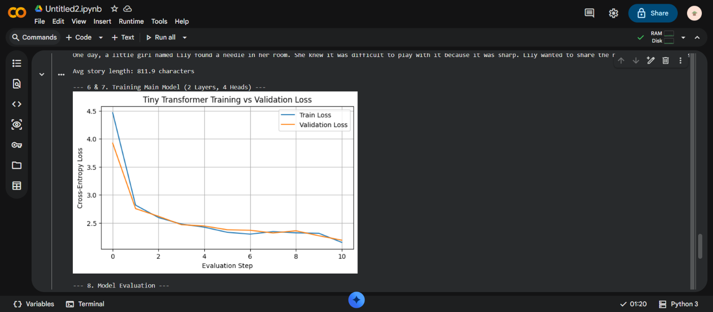

# Lab 03: Developing a Tiny Transformer Language Model

## Objective
Build, train, and evaluate a character-level Tiny Transformer language model from scratch using PyTorch and the Hugging Face TinyStories dataset.

## Tasks and Implementation
1. **Dataset Loading & Exploration:** Loaded a subset of 300 stories from `roneneldan/TinyStories` (average story length: 811.9 characters).
2. **Preprocessing & Data Preparation:** Applied character-level tokenization and created input/target sequences for next-token prediction.
3. **Transformer Architecture:** Implemented token embeddings, positional embeddings, masked multi-head self-attention, feed-forward layers, residual connections, and layer normalization.
4. **Training & Monitoring:** Trained the model using Cross-Entropy Loss and the AdamW optimizer, plotting training vs. validation loss curves.
5. **Evaluation & Story Generation:** Evaluated validation loss (`2.1923`) and perplexity, generated text from the prompt *"Once upon a time"*, experimented with layer/head configurations, and saved the trained model (`tiny_transformer.pt`).

## Results and Evidence
* **Notebook:** [Link to Jupyter Notebook](./notebook/tiny_transformer.ipynb)
* **Training & Validation Loss Curve:**

## Observations & Performance Mechanisms
* Both training and validation loss decreased steadily across evaluation steps, showing effective learning without severe overfitting.
* **Key mechanisms improving performance:** Masked self-attention prevents the model from seeing future tokens, residual connections prevent vanishing gradients, and layer normalization stabilizes training.
